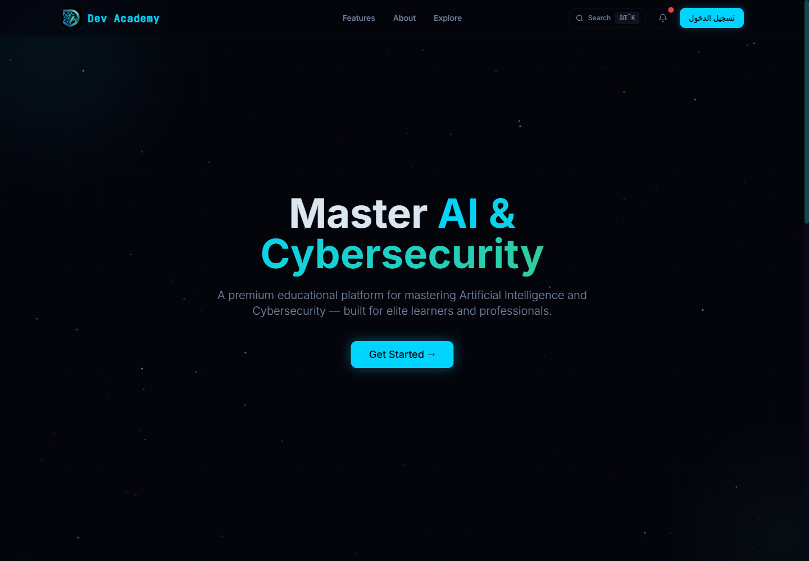
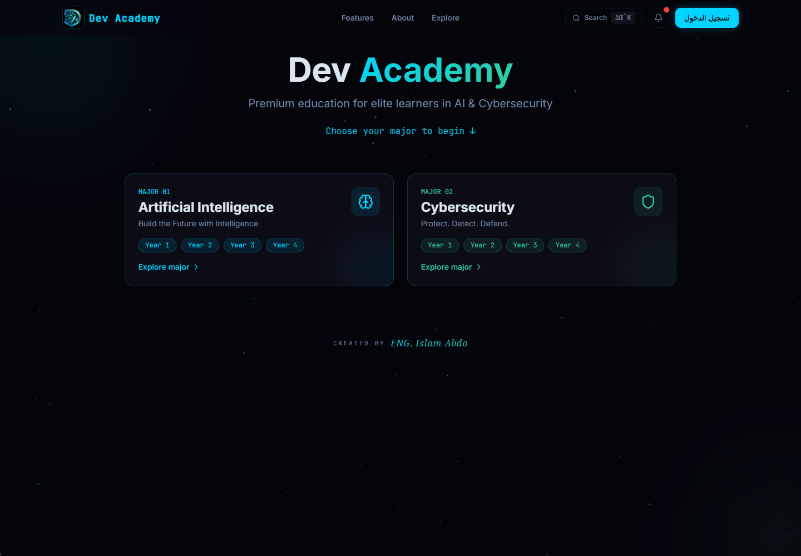
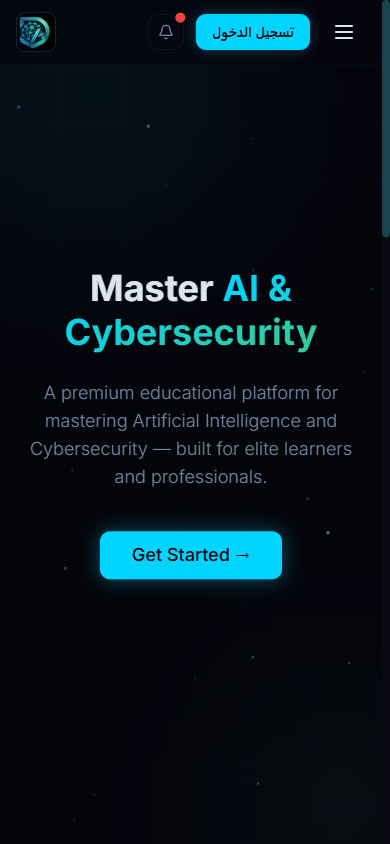

# Dev Academy

[](https://react.dev)
[](https://vite.dev)
[](https://supabase.com)
[](https://developers.cloudflare.com/pages/)
[](LICENSE)

**Arabic-first study platform for computer science students** — curated lectures, summaries, past exams, and shareable study lists for Artificial Intelligence and Cybersecurity.

Dev Academy (ديف أكاديمي) brings scattered course material into one organized place: browse by major → year → semester → subject, preview files in the browser, save a personal library, and share lists with classmates.

> Live site: [dev-academy.pages.dev](https://dev-academy.pages.dev)
>
> Launch-readiness results: [REPORT.md](REPORT.md)



<p align="center">
  
  
</p>

## Features

- **Google-only sign-in** — public login uses Google OAuth; there is no public email/password signup, password reset, or email invitation flow.
- **Structured catalog** — AI and Cybersecurity majors, four academic years, two semesters each, subjects, chapters, sections, and materials.
- **In-browser previews** — PDF, images, video, audio, text/code, interactive HTML (isolated sandbox), Office documents, Google Drive, YouTube, and archives.
- **Personal library** — upload private files, organize saved items into lists, and download or share.
- **Public sharing** — revocable view/download links for single files or whole lists.
- **Publishing workflow** — students submit personal files for review; staff approve and publish into the official catalog.
- **Staff dashboard** — subjects, resources, team roles, publish requests, and storage administration. Members must sign in with Google before an admin can assign their role.
- **Arabic RTL UI** — responsive layout, dark theme, accessible keyboard navigation.
- **Storage split** — Supabase for auth/DB/legacy media/avatars; Hugging Face private bucket (through a Cloudflare Worker and same-origin Pages Function) for personal study files, with per-user quotas and reservation-based accounting.
- **Privacy-friendly analytics** — Cloudflare Web Analytics for visitors plus an in-app admin summary for registered users and daily activity.

## Tech Stack

| Layer | Technology |
| --- | --- |
| Frontend | React 18, Vite 7, React Router 7, Tailwind CSS 3, Radix UI, Framer Motion, Recharts |
| Auth / Database | Supabase Auth + Postgres with Row Level Security |
| File storage | Supabase Storage (legacy media/avatars), Hugging Face private bucket via Cloudflare Worker + Pages Function |
| Edge API | Cloudflare Workers (`workers/hf-upload`) with `aws4fetch` |
| Email | Supabase Email provider disabled; Google OAuth only (legacy break-glass disabled in production) |
| Hosting | Cloudflare Pages |
| Analytics | Cloudflare Web Analytics |

## Project Structure

```
app/                    React/Vite frontend
  public/               static assets, _headers, _redirects, robots.txt
  scripts/prerender.mjs per-route HTML metadata + sitemap + 404 shell
  src/
    components/         UI, browse, material, share, dashboard
    hooks/              auth, storage, sharing, saved lists
    lib/                Supabase client, storage Worker client, SEO routes
    pages/              public and dashboard routes
db/
  migrations/           ordered SQL migrations (schema, RLS, RPCs)
  functions/invite-user legacy email function (not called by the public flow)
workers/hf-upload/      signed Hugging Face upload/delete Worker
scripts/                seed, migration apply, export helpers
brand/                  logo source
```

## Getting Started

Requirements: Node.js 20+ and npm 10+.

```bash
git clone <your-repo-url>
cd dev-academy
npm --prefix app install
cp app/.env.example app/.env
npm --prefix app run dev
```

Open `http://localhost:5173`.

### Environment variables

Copy examples only; never commit real values.

- `app/.env.example`
  - `VITE_SUPABASE_URL`
  - `VITE_SUPABASE_ANON_KEY`
  - `VITE_TURNSTILE_SITE_KEY` (used by the legacy break-glass login)
  - `VITE_HF_UPLOAD_WORKER_URL`
  - `VITE_ENABLE_LEGACY_LOGIN` (default `false`; production is disabled and `/legacy-login` redirects to `/login`)
- `workers/hf-upload/.dev.vars.example`
  - `HF_ACCESS_KEY_ID`
  - `HF_SECRET_ACCESS_KEY`
  - `HF_NAMESPACE`
  - `HF_BUCKET`
  - `SUPABASE_URL`
  - `SUPABASE_ANON_KEY`
  - `SUPABASE_SERVICE_ROLE_KEY` (Worker secret only)
  - `ALLOWED_ORIGINS`
- root `.env.example` (local scripts only)
  - Supabase management/seed variables, Hugging Face export variables, Cloudflare deploy variables.
  - `TURNSTILE_SECRET_KEY` for Supabase Auth captcha configuration.
  - `BACKUP_ARCHIVE_PASSWORD`, `ONEDRIVE_BACKUP_DIR`, `PG_DUMP_BIN`, `SEVEN_ZIP_BIN` for encrypted backups.

`VITE_*` values are public in the browser bundle. Never put a service-role key, Hugging Face secret, or provider API secret in a `VITE_*` variable.

### Database migrations

```bash
# from the repository root, after filling root .env
node scripts/db-apply.mjs --list
node scripts/db-apply.mjs
```

Apply migrations in order. Do not use `supabase db push` against the hosted project unless you have reviewed the pending set.

### Upload Worker

```bash
cd workers/hf-upload
npm install
npx wrangler secret put HF_ACCESS_KEY_ID
npx wrangler secret put HF_SECRET_ACCESS_KEY
npx wrangler secret put SUPABASE_SERVICE_ROLE_KEY
# set HF_NAMESPACE, HF_BUCKET, SUPABASE_URL, ALLOWED_ORIGINS in wrangler.jsonc or dashboard
npm run deploy
```

Then set `VITE_HF_UPLOAD_WORKER_URL` in `app/.env` to the deployed Worker URL.

## Build & Deploy

```bash
cd app
npm run build
```

`npm run build` runs Vite, then `scripts/prerender.mjs` to generate per-route metadata, `404.html`, public/app/dashboard shells, and `sitemap.xml`.

Cloudflare Pages settings:

- Root directory: `app`
- Build command: `npm run build`
- Output directory: `dist`
- Build-time `VITE_*` values come from `app/.env` (gitignored) and are baked into the bundle.
- The Pages dashboard holds the runtime variables used by the Pages Function (`HF_*`, `SUPABASE_*`, `ALLOWED_ORIGINS`); it does not need the `VITE_*` values while deploys are manual.
- Production uses `VITE_ENABLE_LEGACY_LOGIN=false`; `/legacy-login` redirects to `/login`. The route remains `noindex, nofollow` and unlinked. Do not re-enable it unless the Email provider is also re-enabled deliberately.

### Deploying (manual, clean commit only)

```powershell
powershell -NoProfile -ExecutionPolicy Bypass -File scripts/deploy.ps1
```

The script refuses to deploy when the working tree is dirty or the branch is not `master`, runs typecheck and build, and records the commit hash on the Pages deployment. The Pages project's production branch is `main`; the repository branch is `master`.

Security headers live in `app/public/_headers`. SPA fallbacks are limited to `/s/*` → `/app-shell` and `/dashboard/subjects/*` → `/dashboard-shell`; legacy `/admin/*` paths 301 to their `/dashboard/*` equivalents, and unknown paths return the static `404.html`.

## Security

- Public authentication is Google OAuth only. `/legacy-login` is disabled in production (`VITE_ENABLE_LEGACY_LOGIN=false`), redirects to `/login`, and remains unlinked/noindex as source-level fallback.
- Row Level Security is enabled on application tables; staff-only RPCs verify roles server-side.
- The browser never receives service-role or Hugging Face secrets.
- File uploads validate size, MIME type, and extension; object paths are user-scoped and canonicalized.
- Rate limits cover shares, publish requests, messages, and storage reservations.
- CSP, HSTS, `X-Content-Type-Options`, `X-Frame-Options`, `Referrer-Policy`, and `Permissions-Policy` are set at the edge.
- HTML previews run in an isolated `allow-scripts` iframe without same-origin access. Supabase serves public Storage HTML as `text/plain` by design, so HTML materials use the in-app preview rather than a direct Storage URL.

See [SECURITY.md](SECURITY.md) for reporting a vulnerability.

## Operations

### Encrypted off-site backup

`scripts/backup-offsite.mjs` dumps the `public`, `auth`, and `storage` schemas, copies all legacy Supabase `media` objects from a persistent cache, records the public Hugging Face dataset inventory, creates an encrypted 7z archive (`-mhe=on`), writes a SHA256 file, copies the archive to OneDrive, and prunes backups older than 14 days.

```powershell
# from the repository root, after filling root .env
powershell -NoProfile -ExecutionPolicy Bypass -File scripts/run-backup-offsite.ps1
```

Media objects are cached once in `exports/backups/.media-cache/` (gitignored) with a size/etag manifest. Later runs reuse the cache and only download new or changed objects. Downloads are written to a `.part` file and renamed on success, so an interrupted run never leaves a truncated object behind; each download is retried three times and each object is checked against its Storage-reported size. `BACKUP_RESUME=0` forces a full re-download. The database dump is verified with `pg_restore --list` before the archive is created, and staging directories left by interrupted runs are pruned after two days.

The wrapper retries the whole backup once after five minutes. If the direct database host resolves IPv6-only (`db.<ref>.supabase.co`), set `SUPABASE_DB_HOST`, `SUPABASE_DB_PORT=5432`, and `SUPABASE_DB_USER=postgres.<ref>` to the Supabase session pooler values shown in Dashboard → Connect.

The Windows task `DevAcademy Offsite Backup` runs the wrapper daily at 12:00, starts when the machine becomes available, and requires an active user session. It sets `BACKUP_INCLUDE_HF=0`; the 144-file public HF dataset is inventoried but not re-downloaded. Set `BACKUP_INCLUDE_HF=1` for a manual full-media copy. PITR is not available on the current plan; keep the daily archive and verify restores periodically.

The Windows task `DevAcademy Backup Check` runs `scripts/check-backup-freshness.ps1` daily at 20:00 and fails if the newest OneDrive archive is older than 36 hours. On failure it writes `C:\Users\islam\OneDrive\DevAcademyBackups\BACKUP-ALERT.txt`; the alert is removed automatically on the next successful check. Results are appended to `exports/backups/backup-check.log`.

### Turnstile

Supabase Auth captcha is configured with the Turnstile widget `Dev Academy Auth`. The site key is public and belongs in `app/.env`; the secret belongs only in Supabase Auth settings and the root local `.env`. The public Google button does not use Turnstile, and the legacy email/password page is disabled in production.

### Google-only cutover

Production is strict Google-only (Pages deployment `6db47b49`): `VITE_ENABLE_LEGACY_LOGIN=false`, Supabase `external.email=false` / `external.google=true`, and `/legacy-login` redirects to `/login`. A full Google OAuth login as a `super_admin` was verified after the cutover.

Six non-Google accounts were retired in place by explicit decision; their rows, roles, and data were not deleted. Five use Gmail and can self-link through Google later. `admin@devacademy.dev` owns 7 subjects, 18 lectures, and 6 resources that remain manageable by other staff. Re-enabling the Email provider would require a deliberate rollback of both Supabase Auth and the build flag.

## Roadmap

- Full SSR or static generation for catalog pages.
- Native password-protected share links.
- Richer analytics dashboard and alerting.
- Automated browser tests for upload/share/publish flows.

## Author

**Islam Abdo** — founder and maintainer.
GitHub: [@islam-abdo-1](https://github.com/islam-abdo-1)

## License

[MIT](LICENSE)
